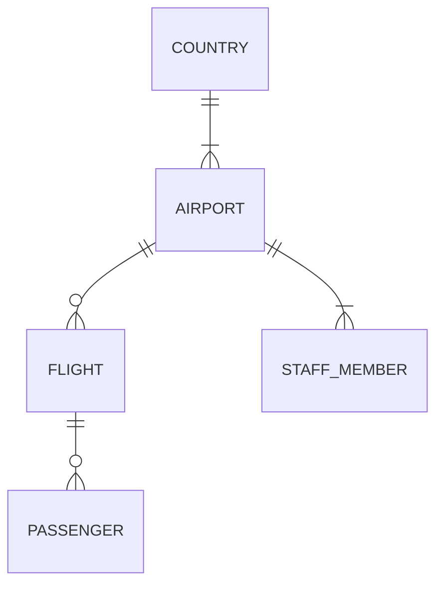

!!! note

    This feature is performed after all business rules have been applied. A `missing_parent` check will be performed, followed by a `no_valid_records` and then finally with a `missing_parent` check again (in case this results in new missing parents). Details on `missing_parent` and `no_valid_records` can be found within this page.

Sometimes a user may choose to use the file transformation stage to `normalise` a heavily nested dataset into separate entities during the initial reading of data. This would be done by specifying different entities in the dataset section of the contract configuration in the `dischema` file. This allows for easier interaction when customising errors in the data contract or writing transformations in the business rules.

`Normalising` assets can lead to structural validations being required. For example in the flights dataset:



We now have a number of entity relationships generated from the normalised model. In the case above, the ERD states...

- A Country must have at least one valid airport
- An Airport must have at least one valid country
- An Airport must have at least one valid staff member
- An Airport may have zero to many flights
- A Staff Member must have at least one valid Airport
- A Flights may have zero to many passengers
- A Flights must have at least one valid Airport
- A Passenger must have at least one valid Flight

This creates a scenario where you would want to apply structual integrity checks to ensure that partial and/or invalid data is not passing validation. I.e. you wouldn't want an aiport flowing beyond validation if there is no valid country.

### Missing Parent Records

It could be that an airport record is deemed invalid and removed. Due to this, any flight records that linked to the now removed airport record are themselves invalid - a situation we refer to as a `missing_parent` issue, but are now existing in an entirely different entity.

### No Valid Mandatory Records

It could also be the case that staff records are a mandatory field for airport records. If all staff records for a particular airport record are removed during validation, this itself would invalidate the airport record - a situation we refer to as `no_valid_records` issue - but again the invalid airport record is in a different entity.

### Dischema

In order to perform these validations, you must specify an `entity_relationships` section within the `dischema`. For example:

```json
{
    "contract": {...},
    "transformations": {...},
    "entity_relationships": {
        "my_entity": {...}
    }
}
```

You can find complete examples [here](https://github.com/NHSDigital/data-validation-engine/tree/main/tests/testdata/flights/).

## Entity Relationships Content

To allow the DVE to link between normalised assets, the following information should be provided (per linkable entity):

- `parent_entity`: the immediate parent of the entity
- `join_fields`: how to join the entity with its parent in dictionary form (parent_field_name: child_field_name)
- `is_root_entity`: indicates that the entity is a root node in a hierarchical model
- `mandatory`: whether the child entity is a mandatory field in the immediate parent

There is also the functionality to customise errors related to either missing parent or group rejections:

- `missing_parent_id_error_code`: the error code to display if a record is rejected as it has no valid parent record
- `missing_parent_id_error_message`: the error message to display if a record is rejected as it has no valid parent record
- `no_valid_records_error_code`: the error code to display if parent records are removed due to no valid children in a mandatory field
- `no_valid_records_error_message`: the error message to display if parent records are removed due to no valid children in a mandatory field
- `empty_entity_post_br_error_code`: the error code to display if a __mandatory__ entity has any records post filtering
- `empty_entity_post_br_error_message`: the error message to display if a __mandatory__ entity has any records post filtering

!!! note
    Specifying root entities is __optional__. Root entities will be inferred based on their absence.
    You may wish to specify root entities so that error codes and messages can be customised (e.g. empty entity).
    
    When specifying root entities you should ensure that parent_entity and join_fields values are left blank.

## Entity Hierarchy Object

The details provided in the entity_relationships section of the dischema are used to create an EntityHierarchy object.
Please refer to [Advanced User Guidance: Entity Hierarchy](../advanced_guidance/package_documentation/entity_hierarchy.md).
